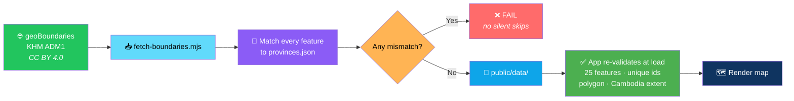
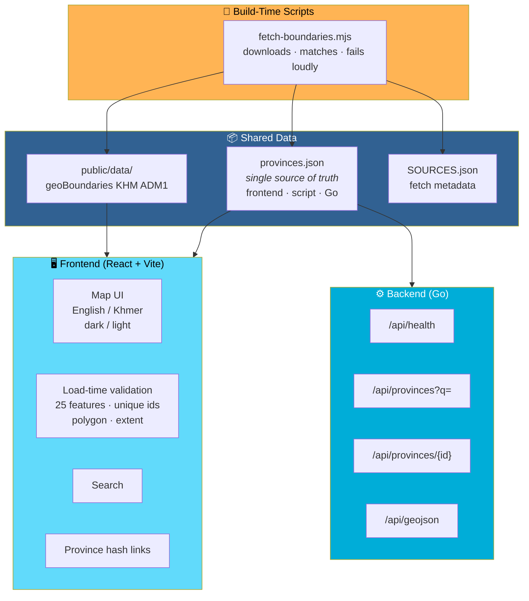

# 🇰🇭 Cambodia Explorer

<div align="center">


**An interactive map of Cambodia's 25 first-level units.**

*24 provinces + Phnom Penh · English / Khmer · Dark / light*

[🚀 Quick Start](#-quick-start) • [📐 Data Rules](#-data-rules) • [🏗️ Architecture](#️-architecture) • [⚠️ Not Implemented](#-not-implemented-yet-honest-list)

</div>

---

## 📖 Overview

**Cambodia Explorer** is an **interactive map** of Cambodia's **25 first-level administrative units** — 24 provinces plus Phnom Penh, the capital.

### Core Idea

> **Real boundaries, or no map at all.**
>
> The boundaries are **never hand-drawn**. If the fetch fails, the UI shows an error instead of a fake map. The app **re-validates at load**: exactly 25 features, unique known ids, polygon geometry, and Cambodia extent.

### What It Does

- **Interactive map** of Cambodia's 25 first-level units
- **English / Khmer** UI
- **Dark / light** theme
- **Drawn from GeoJSON only** — **no tiles, no API keys, no paid services**
- **Province hash links** for sharing

---

## 🚀 Quick Start

### 1. Fetch Boundaries

```bash
node scripts/fetch-boundaries.mjs
```

**Requires Node 18+.**

**What it does:**

- Downloads **geoBoundaries KHM ADM1** *(**CC BY 4.0**)*
- **Matches every feature** to `provinces.json`
- **FAILS on any mismatch** — no silent skips

**Or point it at your own file:**

```bash
node scripts/fetch-boundaries.mjs my.geojson
```

### 2. Run the Frontend

```bash
cd frontend && npm install && npm run dev   # http://localhost:5173
```

### 3. Run the Tests

```bash
npm test
```

**Vitest covers:**

- Counts
- Ids
- Khmer names
- Search
- Geo utilities

### 4. *(Optional)* Run the Go Backend

```bash
cd ../backend && go test ./... && go run ./cmd/server
```

**API on `:8080`:**

| Endpoint | Purpose |
|----------|---------|
| **`/api/health`** | Health check |
| **`/api/provinces?q=`** | Search |
| **`/api/provinces/{id}`** | Single province |
| **`/api/geojson`** | GeoJSON payload |

### 5. Production

**Frontend:**

```bash
cd frontend && npm run build
```

**Serve `dist/` from any static host.**

**Backend:**

```bash
go build ./cmd/server
```

**Run the Go binary behind the same origin.**

> 💡 **Config via `.env.example`.**
>
> **No API keys or paid services** — **the map is drawn from GeoJSON only.**

---

## 📐 Data Rules

> **This is the part that makes Cambodia Explorer trustworthy.**

### 🗺️ Boundaries

<div align="center">

| Rule | Implementation |
|------|---------------|
| **Never hand-drawn** | Boundaries come from **geoBoundaries KHM ADM1** *(**CC BY 4.0**)* |
| **Fail loudly** | **If the fetch fails, the UI shows an error instead of a fake map** |
| **Re-validated at load** | **Exactly 25 features** · **unique known ids** · **polygon geometry** · **Cambodia extent** |

</div>

### 📛 Names

> **`frontend/src/data/provinces.json` is the single source** — used by the frontend, the fetch script, and the Go backend.

<div align="center">

| Rule | Implementation |
|------|---------------|
| **Source spellings** | Go in **`aliases`** |
| **Official names** | **Never silently changed** |
| **⚠️ Khmer names** | **Verify against Cambodian government sources before publishing** |

</div>

### 📊 Data Availability

> **Area, population, neighbors, and destination coordinates are intentionally "Data not available" / "pending verification" until you add sourced values *(with year)*.**
>
> **Nothing is estimated.**

### 🗺️ Geometry Quality

> **geoBoundaries geometry is simplified — not survey-grade.**

**Attribution:**

- **Shown on the map**
- **Fetch metadata saved to `public/data/SOURCES.json`**

### 🏗️ The Data Pipeline



---

## 🏗️ Architecture

### System Overview



### Design Principles

<div align="center">

| Principle | Implementation |
|-----------|---------------|
| **🗺️ Real data, or no map** | **Boundaries are never hand-drawn** — if the fetch fails, the UI shows an **error**, not a fake map |
| **✅ Validation on both ends** | The fetch script **fails on any mismatch** — and **the app re-validates at load** |
| **🔗 One source of truth** | `provinces.json` is used by the **frontend**, the **fetch script**, and the **Go backend** |
| **📛 Never silently change names** | Source spellings go in **`aliases`** — official names stay intact |
| **🚫 No estimates** | Area, population, neighbors, and destination coordinates say **"Data not available"** until sourced values exist |
| **🌐 No tiles, no API keys** | The map is drawn from **GeoJSON only** — no paid services |
| **📜 Attribution everywhere** | Shown on the map, plus fetch metadata in `SOURCES.json` |
| **🔗 Shareable by default** | **Province hash links are supported** |
| **🚫 No fake features** | The **Not Implemented** section is the standard |

</div>

---

## 📝 Not Implemented Yet *(Honest List)*

> **These are not built — and not faked.**

<div align="center">

| Feature | Status |
|---------|:------:|
| **Cinematic hero** | ❌ |
| **Separate pages** | ❌ |
| **Layer toggles** — rivers, roads, protected areas | ❌ |
| **Basemap / satellite / terrain styles** | ❌ |
| **Statistics charts** | ❌ |
| **Province comparison** | ❌ |
| **Share-by-view** | ✅ *(province hash links are supported)* |
| **PostGIS** | ❌ — **not needed until spatial queries/stats exist** |
| **Docker files** | ❌ |
| **Khmer UI strings** | ⚠️ **Need native review** |
| **Destination markers** | ❌ — **await verified coordinates** |

</div>

> ⚠️ **We'd rather list what isn't there than ship a fake button.**

---

## 🗺️ Roadmap

### ✅ Current

- [x] Interactive map of Cambodia's 25 first-level units
- [x] 24 provinces plus Phnom Penh, the capital
- [x] English / Khmer UI
- [x] Dark / light theme
- [x] GeoJSON-only rendering — no tiles, no API keys
- [x] Fetch script for geoBoundaries KHM ADM1 (CC BY 4.0)
- [x] Fetch script fails on any feature mismatch — no silent skips
- [x] Load-time validation — 25 features, unique ids, polygon geometry, Cambodia extent
- [x] Single source of truth for province names shared by frontend, script, and backend
- [x] Source spellings preserved in `aliases`
- [x] "Data not available" placeholders for unverified area, population, neighbors, and destination coordinates
- [x] Attribution shown on the map
- [x] Fetch metadata saved to `public/data/SOURCES.json`
- [x] Province hash links for sharing
- [x] Frontend in React + Vite with Vitest test suite
- [x] Optional Go backend with health, search, single-province, and GeoJSON endpoints
- [x] `.env.example` for configuration
- [x] Production build path documented

### 🔜 Future Ideas

- [ ] **Cinematic hero** on the landing view
- [ ] **Separate pages** per province
- [ ] **Layer toggles** — rivers, roads, protected areas
- [ ] **Basemap, satellite, and terrain styles** — if a paid provider is acceptable
- [ ] **Statistics charts** — population, area, and other sourced data
- [ ] **Province comparison mode**
- [ ] **PostGIS** — only once spatial queries and statistics justify it
- [ ] **Docker files** for a one-command deployment
- [ ] **Khmer UI strings** — reviewed by a native speaker
- [ ] **Destination markers** — once verified coordinates are available

---

## 🤝 Contributing

Contributions are welcome. Please:

1. Fork the repository
2. **Never hand-draw a boundary** — if the source fails, show an error
3. **Never silently change an official name** — add the variant to `aliases`
4. **Never estimate a number** — use "Data not available" until you have a sourced value
5. **Keep `provinces.json` the single source of truth** — frontend, script, and Go backend all use it
6. **Preserve load-time validation** — 25 features, unique ids, polygon geometry, Cambodia extent
7. **Show attribution** — on the map and in `SOURCES.json`
8. **Update the Not Implemented list** when you add a feature
9. Submit a Pull Request

### Guidelines

- **Never ship a fake map** — the error state is the fallback
- **Never add a required paid service** — the map is GeoJSON-only by design
- **Never claim a data point is verified** without a source and year
- **Never remove load-time validation** — it is the safety net
- **Never present a stub as a feature** — the **Not Implemented** section is the standard

---

## 📜 License

MIT — see [LICENSE](LICENSE) for details.

> 📝 **Boundary data:** geoBoundaries KHM ADM1 — **CC BY 4.0**.
>
> **Attribution is shown on the map** and recorded in `public/data/SOURCES.json`.

---

## 🙏 Acknowledgments

- **geoBoundaries** — for open, redistributable administrative boundaries
- **Every Cambodian cartographer who's ever corrected a province name** — this one's for you

---

<div align="center">

### 🇰🇭 REAL BOUNDARIES. REAL NAMES. NO ESTIMATES.

**An interactive map of Cambodia's 25 first-level units.**

**GeoJSON only. No tiles. No API keys. No fake map.**

<br>

> ⚠️ **Khmer names need review against Cambodian government sources before publishing.**

<br>

⭐ If Cambodia Explorer helped you, consider giving it a star.

<br>

[⬆ Back to Top](#-cambodia-explorer)

</div>
